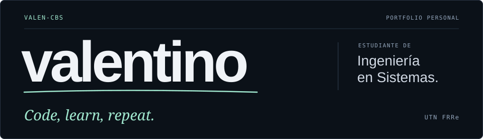
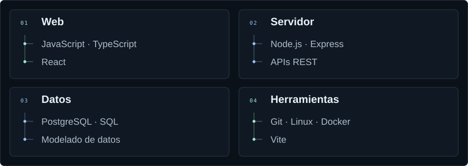
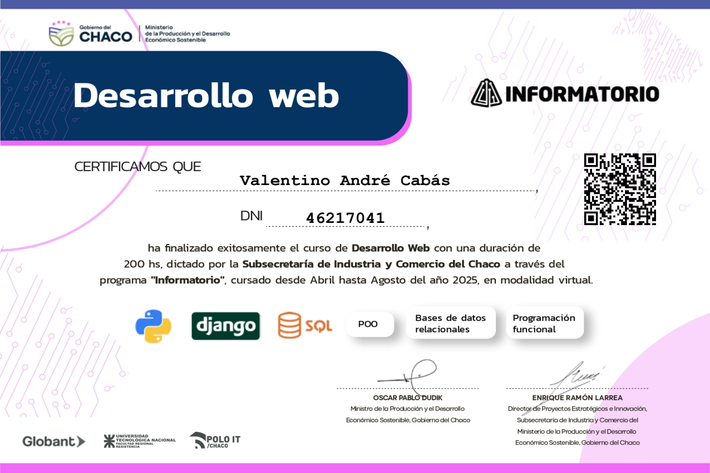
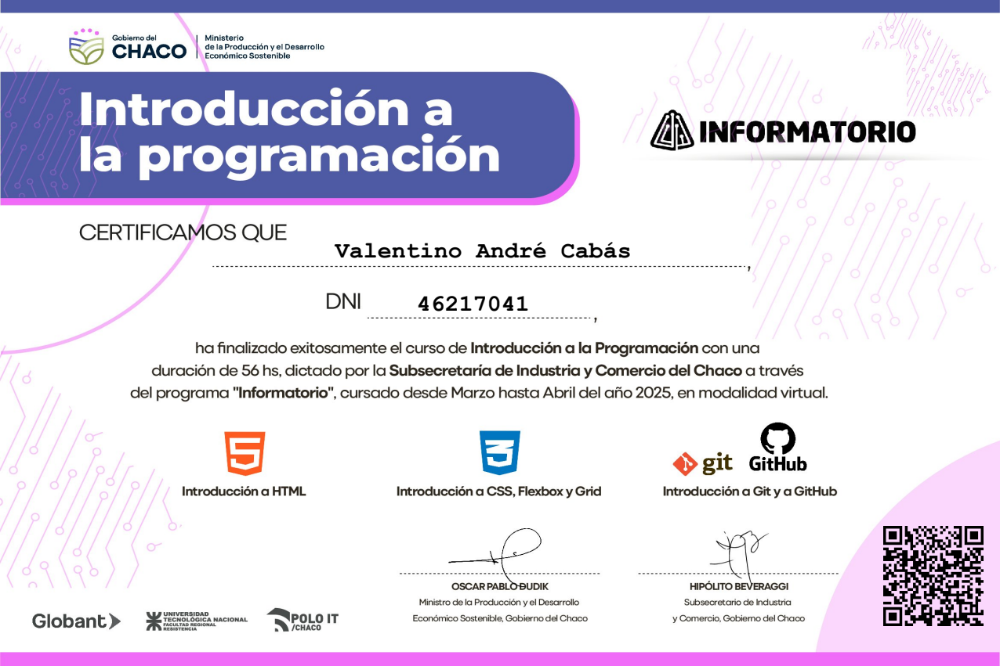

<picture>
  <source media="(max-width: 600px)" srcset="assets/banner-mobile.svg">
  
</picture>

  <a href="#sobre-mi">Sobre mí</a> &nbsp;·&nbsp;
  <a href="#habilidades">Habilidades</a> &nbsp;·&nbsp;
  <a href="#proyectos">Proyectos</a> &nbsp;·&nbsp;
  <a href="#aprendizajes">Aprendizajes</a>

# Sobre mí

Estudio **Ingeniería en Sistemas de Información en la UTN Facultad Regional Resistencia** y estoy finalizando mi tercer año.

Desarrollo aplicaciones web. Me interesan la arquitectura de software, las bases de datos y las experiencias de usuario bien construidas.

## 01 / Habilidades

<picture>
  <source media="(max-width: 600px)" srcset="assets/skills-mobile.svg">
  
</picture>

<strong>Fundamentos y experiencia práctica</strong>

En PostgreSQL tengo experiencia práctica con SQL, modelado, índices, transacciones y concurrencia. Continúo profundizando en diseño de sistemas, UML, patrones de diseño y modelado de datos.

## 02 / Proyectos

<!-- PROJECTS:START
Para añadir un proyecto, duplicar el bloque entre PROJECT:CENTRONEA:START y
PROJECT:CENTRONEA:END debajo del existente. Cambiar el identificador del comentario,
el título, la descripción, las tecnologías y los enlaces por información verificada.
Agregar una captura solo cuando exista un archivo real en assets/projects/.
Cada proyecto es un bloque independiente: añadirlo no requiere cambiar las
secciones de habilidades o aprendizajes.
-->

<!-- PROJECT:CENTRONEA:START -->

### [Centronea Automotores ↗](https://centronea.com)

**Catálogo digital y gestión de vehículos para una concesionaria.**

- **Catálogo:** exploración de vehículos y fichas individuales.
- **Administración:** panel protegido para gestionar vehículos y fotografías.
- **CentroAI:** asesor comercial con respuestas por streaming y funciones de voz.

<strong>Tecnologías del proyecto</strong>

**Implementado con** React y Vite en la interfaz, funciones serverless de Node.js en Vercel, PostgreSQL en Neon y Cloudflare R2 para fotografías.

[Sitio oficial · centronea.com ↗](https://centronea.com) &nbsp;·&nbsp; [Repositorio ↗](https://github.com/Valen-cbs/Centronea) — código privado; requiere acceso.

<!-- PROJECT:CENTRONEA:END -->
<!-- PROJECTS:END -->

## 03 / Aprendizajes

### En curso

**Certificación de MongoDB.** Actualmente amplío mi formación en bases de datos. También continúo profundizando en arquitectura y diseño de sistemas.

### Cursos completados

**Informatorio · Subsecretaría de Industria y Comercio del Chaco**

<!-- CERTIFICATE:DESARROLLO-WEB:START -->

<strong>Desarrollo Web</strong> · Abril–agosto de 2025 · 200 h

Formación en Python, Django, SQL, programación orientada a objetos, bases de datos relacionales y programación funcional.

[Abrir certificado en PDF ↗](assets/certificates/informatorio-desarrollo-web-2025.pdf)

<!-- CERTIFICATE:DESARROLLO-WEB:END -->

<!-- CERTIFICATE:INTRODUCCION:START -->

<strong>Introducción a la Programación</strong> · Marzo–abril de 2025 · 56 h

Introducción a HTML, CSS, Flexbox, Grid, Git y GitHub.

[Abrir certificado en PDF ↗](assets/certificates/informatorio-introduccion-programacion-2025.pdf)

<!-- CERTIFICATE:INTRODUCCION:END -->

<!-- CERTIFICATES:START
Para añadir certificados, duplicar uno de los bloques CERTIFICATE anteriores.
Actualizar título, fechas, duración, emisor, descripción, imagen y PDF usando
los datos del nuevo certificado. Guardar los archivos en assets/certificates/.
Otra estructura posible (copiar el contenido fuera de este comentario):

#### TÍTULO REAL DEL CURSO
EMISOR REAL · FECHA QUE FIGURA EN EL CERTIFICADO
[Ver certificado](assets/certificates/ARCHIVO-REAL.pdf)
[Verificar credencial](URL-REAL-DE-VERIFICACION)

Para una imagen real, usar:

Usar nombres sin espacios y omitir campos o enlaces sin confirmar.
-->
<!-- CERTIFICATES:END -->

<!-- MONGODB: Cuando se obtenga la certificación, actualizar el estado e incorporar
el título, emisor, fecha y enlace verificable reales. Hasta entonces mantener
"en curso" y no incluir imágenes ni enlaces a certificados inexistentes. -->

---

  Valentino · Code, learn, repeat.

<!-- MAINTENANCE
Presentación: mantener el año de carrera actualizado (referencia: octubre de 2026).
Diseño: assets/banner.svg y assets/skills.svg para escritorio;
assets/banner-mobile.svg y assets/skills-mobile.svg para móvil.
El encabezado es una composición tipográfica. Los diagramas de habilidades
agrupan tecnologías y son independientes de proyectos y aprendizajes.
Los SVG son autónomos: sin JavaScript, fuentes remotas ni servicios externos.
La animación es decorativa; el contenido sigue siendo legible sin movimiento.
El README usa estilos nativos de GitHub: su fondo respeta el tema del visitante.
Revisar los enlaces del sitio y el acceso al código al actualizar cada proyecto.
-->
