<picture>
  <source media="(max-width: 600px)" srcset="assets/banner-mobile.svg">
  
</picture>

  <a href="#sobre-mi">Sobre mí</a> &nbsp;·&nbsp;
  <a href="#habilidades">Habilidades</a> &nbsp;·&nbsp;
  <a href="#proyectos">Proyectos</a> &nbsp;·&nbsp;
  <a href="#practica">Práctica</a> &nbsp;·&nbsp;
  <a href="#aprendizajes">Aprendizajes</a>

# <picture><source media="(max-width: 600px)" srcset="assets/sections/about-mobile.svg"></picture>

Soy estudiante de tercer año de **Ingeniería en Sistemas de Información en la UTN Facultad Regional Resistencia**.

Desarrollo aplicaciones web y me interesan la arquitectura de software, la administración de sistemas gestores de bases de datos y el diseño de interfaces y experiencias UI/UX. También valoro la organización de proyectos y la comunicación efectiva dentro de los equipos.

## <picture><source media="(max-width: 600px)" srcset="assets/sections/skills-mobile.svg"></picture>

<picture>
  <source media="(max-width: 600px)" srcset="assets/skills-mobile.svg">
  
</picture>

<strong>Fundamentos y experiencia práctica</strong>

En PostgreSQL tengo experiencia práctica con SQL, modelado, índices, transacciones y concurrencia. Continúo profundizando en diseño de sistemas, UML, patrones de diseño y modelado de datos.

## <picture><source media="(max-width: 600px)" srcset="assets/sections/projects-mobile.svg"></picture>

### [Centronea Automotores ↗](https://centronea.com)

**Catálogo digital y gestión de vehículos para una concesionaria.**

- **Catálogo:** exploración de vehículos y fichas individuales.
- **Administración:** panel protegido para gestionar vehículos y fotografías.
- **CentroAI:** asesor comercial con respuestas por streaming y funciones de voz.

<strong>Tecnologías del proyecto</strong>

**Implementado con** React y Vite en la interfaz, funciones serverless de Node.js en Vercel, PostgreSQL en Neon y Cloudflare R2 para fotografías.

[Sitio oficial · centronea.com ↗](https://centronea.com)

## <picture><source media="(max-width: 600px)" srcset="assets/sections/practice-mobile.svg"></picture>

### Hacklabs y desafíos CTF

**10 y 11 de octubre de 2026**

Participo en hacklabs y desafíos de captura de bandera (CTF), donde investigo aplicaciones y sistemas para encontrar vulnerabilidades, interpretar pistas y obtener las evidencias que permiten resolver cada reto, como flags o hashes.

Combino la inspección desde las herramientas del navegador y JavaScript con el análisis de consultas y pruebas de inyección SQL. En Linux, exploro cómo se relacionan los procesos y sus identificadores con las conexiones de red: direcciones IP, puertos y sockets. Esta práctica me ayuda a entender el recorrido de los datos entre una aplicación, el sistema operativo y una red local, y a identificar dónde pueden aparecer fallas de seguridad.

### TAP de programación

**29 de agosto de 2026**

Participé en TAP resolviendo problemas de lógica con Python, en una modalidad sin acceso a Internet ni herramientas de IA. Esa experiencia puso a prueba mi capacidad para descomponer un problema, plantear un algoritmo y revisar casos límite con los recursos disponibles.

## <picture><source media="(max-width: 600px)" srcset="assets/sections/learning-mobile.svg"></picture>

### En curso

**Certificación de MongoDB.** Actualmente amplío mi formación en bases de datos. También continúo profundizando en arquitectura y diseño de sistemas.

### Cursos completados

**Informatorio · Subsecretaría de Industria y Comercio del Chaco**

<strong>Desarrollo Web</strong> · Abril–agosto de 2025 · 200 h

Formación en Python, Django, SQL, programación orientada a objetos, bases de datos relacionales y programación funcional.

[Abrir certificado en PDF ↗](assets/certificates/informatorio-desarrollo-web-2025.pdf)

<strong>Introducción a la Programación</strong> · Marzo–abril de 2025 · 56 h

Introducción a HTML, CSS, Flexbox, Grid, Git y GitHub.

[Abrir certificado en PDF ↗](assets/certificates/informatorio-introduccion-programacion-2025.pdf)

---

  Valentino · Think. Build. Repeat.

